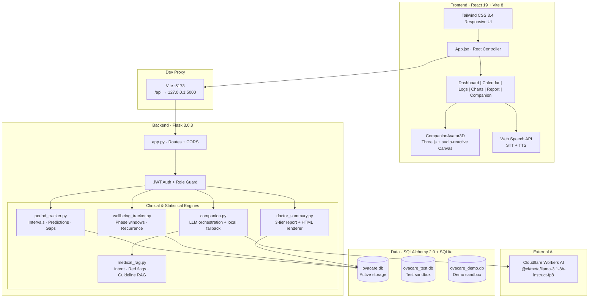

<div align="center">

# 🌸 OvaCare AI

### Explainable cycle forecasting and a clinically safe AI companion for menstrual & PCOS wellness

**It never diagnoses. It explains, supports, and helps patients and clinicians talk to each other.**

[](https://www.python.org/)
[](https://flask.palletsprojects.com/)
[](https://react.dev/)
[](https://vitejs.dev/)
[](https://tailwindcss.com/)
[](https://developers.cloudflare.com/workers-ai/)
[](backend/tests/)

[**⚡ Quick Start**](#-quick-start-3-minutes) · [**🎬 Judge Walkthrough**](#-5-minute-judge-walkthrough) · [**🏛️ Architecture**](#️-system-architecture) · [**📊 Methodology**](#-forecasting-methodology) · [**🛡️ Safety**](#️-ai-companion-architecture--safety) · [**🔮 Roadmap**](#-roadmap)

</div>

---

## 📌 At a Glance

| | |
|---|---|
| **What it is** | A full-stack menstrual health platform: uncertainty-aware cycle prediction, cross-cycle wellbeing insights, a doctor-ready health report, and a guideline-grounded AI companion. |
| **Who it's for** | Anyone who tracks their cycle, especially people with PCOS or irregular cycles whom rigid 28-day apps fail. |
| **Core idea** | Replace false precision with **honest uncertainty**, and replace black-box "health AI" with **deterministic safety rules plus verified citations**. |
| **Try it in 30 seconds** | Click **"Explore Demo Patient"**. No sign-up and no API key needed. |
| **Engineering rigor** | 160 automated tests · isolated test/demo databases · production secret enforcement · zero hallucinated citations by design. |

---

## 💡 The Pitch

Traditional period trackers treat biology like a clock. For the roughly **1 in 10** people with PCOS, and for the many more with naturally variable cycles, that means panic-inducing "your period is late" alerts, unexplainable predictions, and generic advice.

**OvaCare AI rebuilds menstrual tracking from first principles** around four ideas:

1. 🎯 **Uncertainty-aware prediction.** Forecasts come with confidence tiers and a plain-language reason, never a fake-precise date.
2. 🧩 **Gap-aware history.** A forgotten logging month is not a medical irregularity, and the app asks the user instead of guessing.
3. 🩺 **A clinically segregated doctor report.** Facts, statistical estimates, and subjective symptoms are never blended.
4. 🛡️ **A safety-first RAG companion.** Emergencies are caught by deterministic rules *before* any LLM is called, and only verified citations are shown.

---

## 🎯 The Problem

| # | Failure of mainstream apps | Real-world consequence |
|---|---|---|
| 1 | **Rigid 28-day assumption** | Users with PCOS, anovulatory cycles, or long follicular phases get premature "overdue" banners and unnecessary anxiety. |
| 2 | **Tracking gaps treated as medical irregularity** | Forgetting to log for two months pushes the average toward 60+ days and permanently corrupts forecasts. |
| 3 | **The doctor-visit information gap** | Clinicians get screenshots and calendars. Patients can't recall whether cramps were on Day 1 or Day 14, and facts blur with guesses. |
| 4 | **Unsafe, hallucinating health AI** | Generic chatbots invent cures ("cinnamon tea reverses PCOS"), confuse correlation with causation, and fail to escalate emergencies such as suspected ectopic pregnancy or hemorrhage. |

---

## ✨ Our Solution

| Challenge | OvaCare AI approach | Implementation |
|---|---|---|
| **Cycle uncertainty** | History-quality scoring with explainable confidence | Standard deviation and range analysis mapped to 4 tiers: `high`, `moderate`, `uncertain`, `low`. |
| **Tracking gaps** | Detect, then ask the user | Intervals over 45 days become `unclarified_gap`. Users resolve them as `missed_period`, `confirmed_long_cycle`, or `forgotten_entry`. |
| **Clinical communication** | **My Health Report** with strict 3-tier segregation | Category 1 Recorded Facts · Category 2 Statistical Estimates · Category 3 User-Reported Symptoms, with print/PDF export. |
| **Conversational safety** | Deterministic safety layer *around* the LLM | Intent classification before any LLM call, myth detection, emergency override, server-attached citations only. |
| **PCOS inclusivity** | Non-diagnostic PCOS-aware mode | Respects `diagnosed`, `suspected`, or `prefer_not_to_say` and never claims period logs prove a diagnosis. |

### Why it's different

| | Typical tracker | Generic health chatbot | **OvaCare AI** |
|---|:---:|:---:|:---:|
| Handles irregular cycles gracefully | ❌ | ➖ | ✅ |
| Explains *why* a prediction is uncertain | ❌ | ❌ | ✅ |
| Separates tracking gaps from true irregularity | ❌ | ❌ | ✅ |
| Doctor-ready, evidence-tiered report | ➖ | ❌ | ✅ |
| Emergency escalation without an LLM | ❌ | ❌ | ✅ |
| Verified-only citations | n/a | ❌ | ✅ |
| Works fully with no API key | ✅ | ❌ | ✅ |

---

## 🎬 5-Minute Judge Walkthrough

No manual data entry is required.

| Step | Do this | What to notice |
|:---:|---|---|
| **1** | On the landing page click **"Explore Demo Patient"**. | Loads **Maya Demo**, a synthetic profile with **6 completed cycles** and **55 daily wellbeing logs**. |
| **2** | Open the **Dashboard**. | Predicted arrival date, average cycle length (31 days), and an explainability badge: *"Based on 6 consistent recorded cycle intervals with low variance."* |
| **3** | Open **Companion** → **Chat by text** and ask: *"What foods help manage insulin resistance in PCOS?"* | A warm, evidence-grounded reply with verified citations from the **2023 Monash / ESHRE / ASRM** guideline. |
| **4** | Ask: *"I have sudden severe sharp pelvic pain and feel like fainting."* | An **instant safety override** directing the user to emergency care. No LLM is involved. |
| **5** | Open the **Report** tab and click **Print / Save PDF**. | Category 1 Facts · Category 2 Estimates · Category 3 Symptoms, in a page-break-optimized layout for doctors. |
| **6** | Switch to **Jordan Gap Demo** via demo login. | An unclarified **56-day tracking gap** and the active clarification workflow. |

---

## 🏛️ System Architecture



---

## 🛠️ Technology Stack

| Layer | Technologies |
|---|---|
| **Frontend** | React 19.2.6 · Vite 8.0.13 · Tailwind CSS 3.4.17 (glassmorphism tokens, `@media print` styles) · Chart.js 4.5.1 + react-chartjs-2 5.3.1 · Lucide React 1.16.0 · Three.js 0.186.1 · Web Speech API |
| **Backend** | Flask 3.0.3 (Blueprints: `community_bp`, `companion_bp`) · Flask-Cors 4.0.1 (strict origin whitelist) · SQLAlchemy 2.0.30 (parameterized queries) · NumPy 1.26.4 · Pandas 2.2.2 · Requests 2.34.2 · Cryptography 42.0.7 |
| **AI** | Cloudflare Workers AI · `@cf/meta/llama-3.1-8b-instruct-fp8` · curated RAG corpus (2023 International PCOS Guideline by Monash/ESHRE/ASRM, plus WHO, NHS UK, ACOG) · pure-Python safety classifiers · deterministic local fallback |
| **Data** | SQLite (optional MySQL for production) with separate active, test, and demo databases |

---

## 📊 Forecasting Methodology

> **Design principle:** *Honest uncertainty beats false precision.*

### 1. Cycle intervals

For chronologically ordered period start dates $D = [d_1, d_2, \dots, d_n]$:

$$I_k = d_{k+1} - d_k \quad \text{for } k \in [1, n-1]$$

### 2. Physiological filtering

| Class | Rule | Treatment |
|---|---|---|
| **Physiological** | $21 \le I_k \le 45$ days | Included in averages |
| **Extended interval (tracking gap)** | $I_k > 45$ days | **Excluded** unless the user confirms it as a real long cycle |
| **Short outlier** | $I_k < 21$ days | Flagged for clinical review |

The set of usable intervals is:

$$U = \{\, I_k \mid 21 \le I_k \le 45 \ \lor\ \text{gap\_type}(I_k) = \text{confirmed\_long\_cycle} \,\}$$

$$\bar{L}_{\text{cycle}} = \frac{1}{|U|} \sum_{I_k \in U} I_k$$

If $|U| = 0$, the system falls back to the population baseline: $\bar{L}_{\text{baseline}} = 28$ days and $\bar{L}_{\text{period}} = 5$ days.

### 3. Forecast

$$\hat{d}_{\text{next}} = d_n + \bar{L}_{\text{cycle}}$$

If $t_{\text{now}} > \hat{d}_{\text{next}}$, the delay $\Delta_{\text{delay}} = t_{\text{now}} - \hat{d}_{\text{next}}$ is shown in neutral language and **never penalizes future baselines**.

### 4. Regularity classification (requires $|U| \ge 2$)

$$\sigma = \sqrt{\frac{1}{|U|} \sum_{I_k \in U} (I_k - \bar{L}_{\text{cycle}})^2}, \qquad R = \max(U) - \min(U)$$

| Label | Condition |
|---|---|
| **Regular** | $\sigma \le 4.0$ days **and** $R \le 7$ days |
| **Irregular** | $\sigma > 4.0$ **or** $R > 7$ **or** any `confirmed_long_cycle` |
| **Insufficient data** | $\lvert U \rvert < 2$ |

### 5. Confidence tiers

| Tier | Criteria | Message shown to the user |
|---|---|---|
| 🟢 **High** | ≥ 3 usable intervals, $\sigma \le 4.0$, $R \le 7$, no unresolved gaps | *"Based on N consistent recorded cycle intervals with low variance."* |
| 🟡 **Moderate** | 1 usable interval, **or** ≥ 2 regular intervals with an unclarified gap | *"Calculated from regular history, but an unclarified tracking gap is present."* |
| 🟠 **Uncertain** | ≥ 2 intervals, marked irregular | *"Cycle lengths show natural irregularity; period arrival window may vary."* |
| ⚪ **Low** | 0 completed intervals | *"Using standard population baseline (28 days). Confidence increases with logged cycles."* |

---

## 🔄 Cycle-Gap Clarification Workflow

```text
[Cycle 1: Aug 10] ──────────── 56 days ────────────▶ [Cycle 2: Oct 05]
                                   │
                                   ▼
              Interval > 45 days → tagged 'unclarified_gap'
              Excluded from the rolling average (nothing is silently assumed)
                                   │
        ┌──────────────────────────┼──────────────────────────┐
        ▼                          ▼                          ▼
 "I missed a period"       "I forgot to log"       "This was one long cycle"
 tag: missed_period        tag: forgotten_entry    tag: confirmed_long_cycle
 excluded from average     excluded from average   INCLUDED in history
 not marked irregular      not marked irregular    counted toward irregularity
```

---

## 🧠 Wellbeing Intelligence

The engine ([`backend/common/wellbeing_tracker.py`](backend/common/wellbeing_tracker.py)) detects personal symptom patterns across cycle boundaries.

**Phase windows**

| Window | Definition |
|---|---|
| **Menstrual** | Days $1 \dots L_{\text{period}}$, anchored on confirmed bleeding dates |
| **Premenstrual** | The 5 days before the next onset (marked *estimated*) |
| **Mid-cycle (ovulatory)** | Day $0.40 \times L_{\text{cycle}}$ to Day $0.60 \times L_{\text{cycle}}$ (*estimated*) |
| **Follicular** | Post-menstrual days up to mid-cycle |

**Anti-spurious-correlation guardrails.** A pattern is `supported` only if **all three** hold:

1. Logs exist in that window across **≥ 2 distinct cycles**.
2. The pattern is logged on **≥ 3 cumulative days**.
3. The recurrence ratio is **≥ 0.66**:

$$\text{Recurrence Ratio} = \frac{\text{Cycles with pattern observed}}{\text{Cycles with logs in window}} \ge 0.66$$

**Responsible-language principles**

- **Unrecorded ≠ absent.** A blank field is `unrecorded`, never `None` or `0`.
- **Non-causal.** *"In 3 of your last 4 cycles you reported lower energy premenstrually."* It never says "hormones caused your fatigue."
- **Non-diagnostic.** No labels such as PMDD, dysmenorrhea, or clinical depression.

---

## 🛡️ AI Companion: Architecture & Safety

The Companion combines a 3D audio-reactive avatar, voice in/out, and a **dual-layer** clinical RAG pipeline. The key design choice is that **safety logic runs before and after the LLM, never inside it.**

```text
User query (text or voice)
        │
        ▼
┌─ Intent Classifier & Safety Engine (medical_rag.py) ──────────────────────┐
│                                                                            │
│  🚨 Emergency red flag?  (severe pelvic pain, fainting, soaking >1 pad/hr) │
│        └─▶ EMERGENCY OVERRIDE → immediate ER guidance (no LLM call)        │
│                                                                            │
│  🧪 Medical myth?  (cinnamon cures PCOS, carrot detox, seed cycling)       │
│        └─▶ inject clinical caution + counter-evidence into the prompt      │
└────────────────────────────────────────────────────────────────────────────┘
        │
        ▼
Curated knowledge retrieval (TF-IDF + topic scorer) → 2023 PCOS Guideline snippets
        │
        ▼
Cloudflare Workers AI completion (Llama 3.1 8B fp8)
   └─ falls back to the deterministic Local Evidence Synthesizer if offline or unconfigured
        │
        ▼
Structured Output Validator & Source Sanitizer
   ├─ guarantees a valid JSON schema
   └─ attaches ONLY server-side verified URLs (zero hallucinated citations)
        │
        ▼
Companion.jsx → avatar expression · reply card (30–65 words) · source badges · TTS
```

| Guardrail | How it works |
|---|---|
| **Emergency protection** | Keyword/regex detection of acute indicators (`sudden sharp pain`, `faint`, `pass out`, `hemorrhage`, `torsion`, `ectopic`) overrides generation entirely. |
| **Myth neutralization** | Viral claims and unverified cures get a gentle, evidence-based correction. |
| **Zero hallucinated citations** | Sources come from authentic guideline summaries retrieved server-side. The LLM cannot add URLs. |
| **Graceful degradation** | With no Cloudflare credentials the app still answers from the local guideline knowledge base. |

---

## 🌸 PCOS-Aware, Non-Diagnostic Design

- **Optional self-reported status:** `diagnosed` · `suspected` · `prefer_not_to_say`.
- **Supportive language.** Rigid "late" warnings are replaced with neutral tracking updates.
- **No diagnosis, by principle.** A cycle-tracking algorithm cannot measure biochemical hyperandrogenism, AMH, or ultrasound morphology. OvaCare AI states plainly that irregularity is heterogeneous and needs evaluation by a licensed clinician.

---

## 📋 My Health Report (Doctor Visit Summary)

Generated by [`backend/common/doctor_summary.py`](backend/common/doctor_summary.py). Evidence is **never blended across tiers**:

| Tier | Contents |
|---|---|
| **Category 1: Recorded Facts** | Patient-confirmed period start and end dates · exact bleeding durations · logged flow intensities and distributions |
| **Category 2: Statistical Estimates** | Average cycle and period length · variation spread ($R$) and $\sigma$ · projected arrival window and confidence · explicit disclaimer that projections are *not* laboratory tests |
| **Category 3: User-Reported Symptoms** | Symptom frequencies (cramps, headaches, fatigue, bloating) · patterns meeting the 66% recurrence threshold · average sleep and mood distribution · personal reflections |

**Print/PDF export.** Custom `@media print` rules in [`frontend/src/index.css`](frontend/src/index.css) apply `break-inside: avoid` to cards, headers, and tables, and remove dark backgrounds, shadows, and floating navigation. Output works with any browser's **Save as PDF**.

---

## 🗄️ Database & Data Isolation

SQLite by default, with optional MySQL for production.

```text
users (1) ──< cycles (1) ──< wellness_logs
```

| Table | Key fields |
|---|---|
| **users** | `user_id` PK · `username` · `email` (unique) · `password` · `age` · `lifestyle` · `has_pcos` · `pcos_diagnosis_status` · `role` (default `member`) · `created_at` |
| **cycles** | `cycle_id` PK · `user_id` FK · `start_date` · `end_date` · `cycle_length` · `period_length` · `irregular` · `gap_type` |
| **wellness_logs** | `log_id` PK · `user_id` FK · `date` · `cycle_day` · `mood` · `stress` · `sleep_hours` · `cramps` · `fatigue` · `flow` |

**Production DB protection.** [`backend/db.py`](backend/db.py) guarantees that when `OVACARE_TEST_MODE=true`, tests can **never** touch `backend/ovacare.db`. They run only against `ovacare_test.db`, and `ovacare_demo.db` is a dedicated demo sandbox.

---

## 🔒 Security & Privacy

| Area | Implementation |
|---|---|
| **Authentication** | Stateless JWT. Tokens are verified on all protected `/api/*` endpoints with role guards. |
| **Passwords** | Hashed, never stored in plaintext. |
| **Fail-safe secrets** | With `APP_ENV=production` the backend **refuses to start** on a weak or development-fallback `SECRET_KEY` (32+ characters required). |
| **Token storage** | `localStorage` with `Authorization: Bearer <token>` headers. |
| **LLM data minimization** | Only anonymized clinical context is sent to the model. **No email, name, or database IDs** are included in LLM calls. |
| **CORS** | Strict origin whitelist. |
| **Audit trail** | Security and moderation events carry immutable timestamps. |

---

## ⚡ Quick Start (3 minutes)

**Prerequisites:** Python 3.10+, Node.js 18 or 22 (LTS), Git. The commands below are for Windows PowerShell.

### 1. Clone

```powershell
git clone <your-repo-url> ovacare
cd ovacare
```

### 2. Backend

```powershell
cd backend
python -m venv venv
.\venv\Scripts\Activate.ps1
python -m pip install --upgrade pip
pip install -r requirements.txt
Copy-Item .env.example .env
python app.py            # → http://127.0.0.1:5000
```

### 3. Frontend (new terminal)

```powershell
cd ovacare\frontend
npm install
npm run dev              # → http://localhost:5173
```

> [!TIP]
> **Zero-credential mode.** Leave the Cloudflare variables empty and the built-in Deterministic Clinical RAG Engine answers from the local guideline knowledge base. **No API key is needed to evaluate the full app.**

<details>
<summary><b>⚙️ Environment variables (<code>backend/.env</code>)</b></summary>

| Variable | Required | Default | Purpose |
|---|:---:|---|---|
| `APP_ENV` | **Yes** | `development` | `development` allows a local fallback key. `production` enforces a strong 32+ char `SECRET_KEY`. |
| `SECRET_KEY` | Dev: optional | Auto fallback | Secret used to sign JWTs. |
| `PORT` | No | `5000` | Flask port. |
| `HOST` | No | `0.0.0.0` | Server bind address. |
| `CORS_ORIGINS` | No | `http://localhost:5173,http://127.0.0.1:5173` | Allowed frontend origins. |
| `CLOUDFLARE_ACCOUNT_ID` | Optional | *(empty)* | Enables live Workers AI completions. |
| `CLOUDFLARE_API_TOKEN` | Optional | *(empty)* | Bearer token with Workers AI read permission. |
| `CLOUDFLARE_MODEL` | No | `@cf/meta/llama-3.1-8b-instruct-fp8` | Model for the companion. |

</details>

---

## 🧪 Testing & Verification

**160 unit and integration tests** cover security, forecasting, RAG safety, demo integrity, and clinical segregation.

```powershell
cd backend
.\venv\Scripts\python.exe -m unittest discover tests
# Ran 160 tests in 2.82s — OK
```

| Test module | What it proves |
|---|---|
| `test_cycle_prediction.py` | Forecasting math, gap exclusion, confidence tiers |
| `test_wellbeing_intelligence.py` | 2-cycle / 3-day / 66% recurrence thresholds |
| `test_doctor_summary.py` | Strict 3-tier segregation in the health report |
| `test_companion.py` | RAG, emergency override, myth handling, citation integrity |
| `test_auth_security.py` | Authentication and production secret enforcement |
| `test_db_isolation.py` | Tests can never touch the production database |
| `test_demo_patient.py` | Synthetic demo profiles stay intact |

**Frontend build check**

```powershell
cd frontend
npm run build
# ✓ built in 1.13s  ·  index.css 55.27 kB  ·  index.js 589.52 kB
```

---

## 📁 Project Structure

```text
ovacare/
├── backend/
│   ├── common/
│   │   ├── auth.py               # JWT generation & verification
│   │   ├── doctor_summary.py     # 3-tier clinical summary + HTML renderer
│   │   ├── period_tracker.py     # Cycle math, predictions, gap classification
│   │   └── wellbeing_tracker.py  # Pattern engine, cross-cycle recurrence
│   ├── migrations/               # Community module migration + safe runner
│   ├── tests/                    # 160-test suite (see table above)
│   ├── app.py                    # Flask entrypoint & routes
│   ├── companion.py              # Companion blueprint + Workers AI integration
│   ├── db.py                     # Connection handling & DB-isolation guard
│   ├── medical_rag.py            # Guideline RAG + safety classifier
│   ├── schema.sql                # Core schema
│   └── seed_demo.py              # Synthetic demo patients (Maya, Jordan)
├── frontend/
│   ├── public/                   # Avatar images & 3D assets
│   └── src/
│       ├── components/           # Companion, CompanionAvatar3D, Community
│       ├── App.jsx               # Dashboard, tabs, report viewer
│       └── index.css             # Design system + @media print stylesheet
└── README.md
```

---

## ⚠️ Limitations (stated honestly)

1. **Not a medical device.** No diagnosis of PCOS, endometriosis, PMDD, or any gynecological condition.
2. **Estimated phase windows.** Follicular, ovulatory, and luteal windows are inferred from self-reported bleeding dates, not hormone- or ultrasound-confirmed.
3. **Voice input browser support.** Speech-to-text depends on the Web Speech API (Chrome, Edge, Safari; limited in Firefox). Text chat works everywhere.
4. **Community forum is staged.** `001_community_module.sql` has not been run against the active production database.

---

## 🔮 Roadmap (Future work)

- [ ] **Mobile app** (React Native / Expo) for iOS and Android
- [ ] **FHIR / Apple HealthKit** bidirectional sync (SMART on FHIR)
- [ ] **Multilingual clinical RAG** (Spanish, Hindi, French)
- [ ] **BBT & LH strip scanning** via computer vision

---
<div align="center">

**OvaCare AI** · Designed with care for menstrual health, clinical clarity, and personal wellbeing.

*Not a substitute for professional medical advice. In an emergency, contact local emergency services.*

</div>
